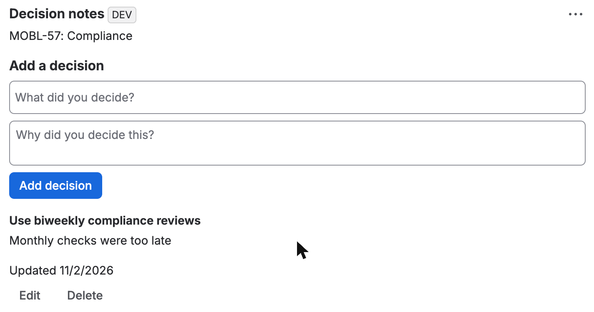

# Issue Decision Notes

A sample Forge app for recording decisions and the reasons behind them on Jira issues. It's a portfolio sample and isn't on the Atlassian Marketplace.

Built with AI assistance. The maintainer reviewed and tested the app before publishing.



## Features

- Issue panel showing the issue key and title
- Add, edit and delete decisions
- Separate decisions for each issue
- Confirmation before deleting
- Admin setting for maximum text length
- Limit of 50 decisions per issue

## Setup

Requires Node 22.23.4 or later on the 22 line, or 24.22.1 or later on the 24 line, plus the Forge CLI.

```bash
npm install
forge register issue-decision-notes
forge deploy
forge install --demo-site
```

## Permissions

| Scope | Why it's needed |
|---|---|
| `read:jira-work` | Reads the issue title and checks the user's access |
| `storage:app` | Saves decisions and the admin setting |

## Tests

```bash
npm test
```

The unit tests cover the decision rules.

These were checked on a Jira development site:

- Panel shows the issue key and title
- Add, edit and delete work
- Saved notes survive a page reload
- Each issue keeps separate notes
- Blank input shows a clear message
- The admin setting blocks invalid values

The 50-decision limit, long text limit and users without issue access haven't been tested in Jira yet.
